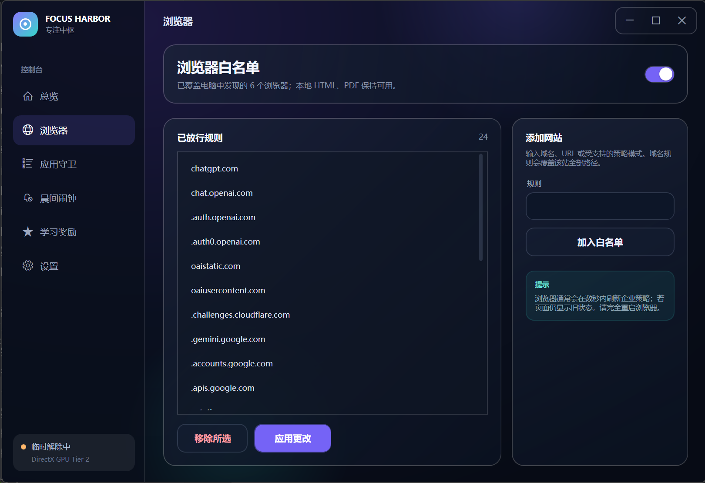

<div align="center">

# Focus Harbor · 专注中枢

当前版本 **1.0.1**

把选择留给清醒的自己。

浏览器白名单 · 应用与文件守卫 · 晨间闹钟 · 学习奖励

[下载单文件 EXE](https://github.com/mofan6/FocusHarbor/releases/latest) · [使用教程](assets/UserGuide.md) · [反馈问题](https://github.com/mofan6/FocusHarbor/issues)

</div>

Focus Harbor 是一款面向 Windows 桌面的本地自律工具。提前设定可以访问的网站、应用允许启动的时段与学习目标，在专注期间锁定相关设置，也给自己保留明确、有限的休息机会。

采用 C#、WPF/XAML 与 DirectX 合成渲染，界面包含深色渐变、圆角卡片、状态动画和实时进度；不打包浏览器内核，不需要每次启动先解压一套运行环境。

## 界面预览

### 专注总览

临时解除倒计时、今日剩余额度、规则预览与累计专注时长，一屏掌握。


### 浏览器白名单

集中维护放行规则，向已发现的受支持浏览器同步策略，保留本地 HTML、PDF 的使用体验。



> 截图展示的是已配置的使用场景，不代表首次启动的默认状态。

## 可以做什么

- **浏览器白名单**：扫描已安装浏览器，集中管理域名、URL 与本地文件放行规则。预置 ChatGPT、Gemini、DeepSeek、千问、腾讯元宝等网站。
- **应用与文件守卫**：添加传统桌面软件、Microsoft Store 应用或普通文件；每条规则支持独立开关、允许启动时段或始终拦截。软件已卸载也可以删除对应的旧规则。
- **专注锁定**：专注期间锁定浏览器与守卫设置；临时解除后才能调整。
- **有限休息**：普通临时解除每天 3 次，每次 30 分钟；可以提前恢复专注，也可以确认后放弃当天剩余额度。
- **学习奖励**：默认提供科目1–4，可在临时解除期间增删、重命名。每科每天完成一份 80–300 字的手打说明，可获得独立的 10 分钟解除奖励。
- **累计专注**：本地持久化保存，关闭窗口后继续记账，下次启动补算符合条件的离线时间。
- **晨间闹钟**：尝试提前唤醒与暖机，在已登录的锁屏会话播放本地音乐；配合至少 150 字、15 分钟内完成的逐字手打任务与实时正确率反馈。支持 FLAC 等音频格式。
- **内嵌教程**：软件中直接阅读和搜索 Markdown 使用文档。

## 下载与开始

1. 前往 [Releases](https://github.com/mofan6/FocusHarbor/releases/latest)，下载 **FocusHarbor-Portable.exe**。
2. 在 Windows x64 桌面环境运行。程序依赖系统的 .NET Framework/WPF 组件；部分计划任务及电源设置需要管理员授权。
3. 首次启动时，所有防护默认关闭、应用守卫列表为空。先添加自己的规则，再主动开启需要的功能。
4. 需要修改规则时，先在总览页临时解除；详细操作见 [完整使用教程](assets/UserGuide.md)。

单文件指分发与启动方式；用户设置、日志及计划任务状态仍会保存到当前 Windows 用户的本机数据目录，不会随 EXE 自动上传或随复制分发。

## 开启晨间闹钟前，请先了解

晨间闹钟是可选的强约束功能。打字超时会执行配置中说明的后果：将明确选定的 **E 盘专用押金文件夹**移动到同盘隔离区，登记 **120 小时后恢复**，并在当天禁用临时解除及阻止 Codex 桌面软件与其本机运行组件。停止音乐不代表完成打字任务，关闭主窗口也不会终止独立的任务进程。

这不是永久删除机制。恢复时若原路径已有同名项目，软件不会覆盖，隔离内容会保留等待处理。请仅使用可承受暂时无法访问的专用测试文件，并另外保留备份；不要放入重要资料。配置仅在每天 **00:00–02:00** 可修改，这段时间不受专注锁定影响。具体校验、恢复方式和限制见 [使用教程](assets/UserGuide.md#晨间闹钟与打字任务)。

唤醒依赖硬件、固件与 Windows 电源设置，不能保证完全关机后自动开机；打字界面需要用户保持登录。它也不是不可绕过的安全边界：管理员仍可管理计划任务和系统策略。请不要把本软件作为唯一的起床保障。

## 隐私与边界

- 设置、额度、奖励和专注记录保存在本机；本项目不包含发布者的个人配置或使用记录。
- 浏览器限制依赖对应浏览器的策略支持，并非对所有联网程序的全局网络封锁。
- 普通文件在支持的本地文件系统上使用可恢复的读取权限限制，恢复记录双份保存在本机；不支持或权限不足时回退独占锁并显示失败原因。EXE 同时使用启动文件锁和精确路径进程拦截。已打开的文档缓存无法撤回，需先手动关闭；应用守卫不是操作系统级安全沙箱。
- 设置页提供“恢复无限制状态”，用于关闭防护、移除浏览器策略并停止守卫。启用前请先阅读教程、理解恢复方式。

## 从源码构建

项目使用系统 C# 编译器，无需额外的 NuGet 包。构建脚本会检查所需的 .NET Framework 与 WPF 程序集。

```powershell
powershell -NoProfile -ExecutionPolicy Bypass -File .\build.ps1
```

输出为 `dist/FocusHarbor.exe`。XAML、图标与 Markdown 教程均嵌入 EXE，用户数据不参与构建。测试工具说明见 [tests/README.md](tests/README.md)；不要在日常使用环境直接运行涉及守卫、额度或闹钟的测试。

```text
src/        应用、界面与后台守卫源码
assets/     图标与软件内嵌教程
docs/       项目截图与发布说明
tests/      回归和界面检查工具源码
tools/      图标生成工具
build.ps1   常规构建入口
```

---

Designed By **MOTAN** · [MOFAN](https://github.com/mofan6)
